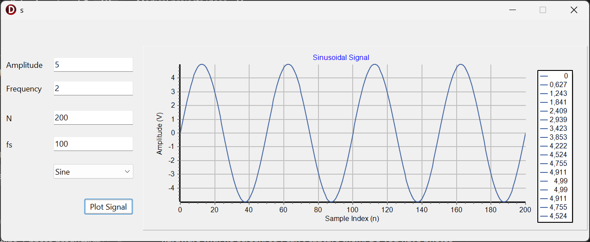

# Sinusoidal Signal Generator

A Delphi VCL app that generates and plots discrete sine and cosine signals, for learning digital signal processing basics.



## Formula
The continuous time `t` is replaced with `n / fs` to get a sampled, digital signal:

```
Sine:    y[n] = A · sin(2π · f · n / fs)
Cosine:  y[n] = A · cos(2π · f · n / fs)
```

## Inputs
| Field | Meaning |
|---|---|
| A | Amplitude |
| f | Signal frequency (Hz) |
| N | Number of samples |
| fs | Sampling frequency (Hz) |
| Combo box | Sine or cosine |

Try changing `fs` relative to `f` to see the effect of sampling rate and aliasing.

## Build
Open `Project1.dproj` in Delphi (RAD Studio, Community Edition works) and run it. It needs the VCL and TeeChart.

## License
Released under the [MIT License](LICENSE).
